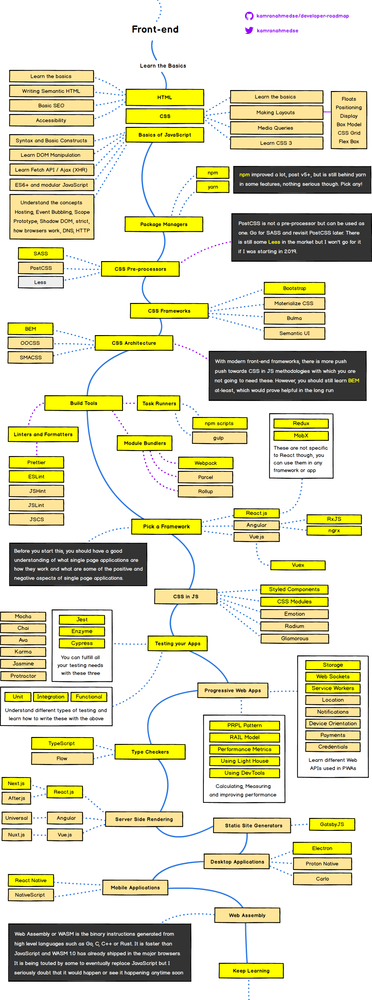

这本书整理我的前端学习与开发经验，目标是帮你**独立做出页面、定位问题，并把项目发布出去**。我会直接写推荐什么、反对什么、为什么这么判断，再告诉你怎么做。作者在实践中形成的取舍，就是这本小书值得读的理由。

本书的立场很明确：

- **英语阅读和 Google 检索是程序员的基本功。** 两项都很差又不愿意补，基本就是在告别这条职业道路，职业发展也很难走远。
- **远离百度，不把低质中文技术社区当学习主线。** 广告、洗稿、过时教程和错误答案不只浪费时间，还会把初学者带偏。默认用 Google 与英文关键词，直接读官方文档和项目讨论。
- **开发笔记本首推 MacBook，预算有限再选 Windows。** 每天使用的屏幕、触摸板、续航与开发环境，值得花钱。
- **亲手做项目，也保留工作之外的好奇心。** 不靠收藏教程和框架新闻证明自己在学习，也不把眼前岗位会用到什么当成知识的边界。

<small>以上是作者的经验与判断。本书欢迎带着理由讨论；事实错误应当修正，观点分歧不必被改成「各有优势、按需选择」。版本、规格与兼容性以所附资料核对，发现错误欢迎提 issue 或 PR。</small>

## 怎么读这本书

- **刚开始学**：从[基本素养](/frontend-guideline/basic/literacy/)和[开发环境](/frontend-guideline/basic/fontend-env/)开始，然后按[学习路线](/frontend-guideline/learning/readme/)完成第一个页面。
- **已经会写页面**：挑一个真实小项目，补齐[框架与库](/frontend-guideline/learning/frameworks/)、[调试](/frontend-guideline/dev/debug/)、[构建发布](/frontend-guideline/dev/pack/)，别只停留在本地能运行。
- **已经在工作**：从当前最常遇到的问题切入，检查[编码规范](/frontend-guideline/learning/guideline/)、[CI/CD](/frontend-guideline/cicd/github/)与[安全优化](/frontend-guideline/misc/security/)，把重复劳动交给工具。

读资料时同步写代码。遇到不会的概念就查，做完把运行方法与取舍写进 README；下次不看教程也能重新完成，才算真正留下了东西。

仓库：[oe/frontend-guideline](https://github.com/oe/frontend-guideline)。欢迎[报告具体问题](https://github.com/oe/frontend-guideline/issues)或[补充内容](https://github.com/oe/frontend-guideline/pulls)。

## 前端知识图谱

这张旧路线图用于认识知识分类，别把它当成开工前必须背完的清单。点击图片查看持续更新的路线，再选自己下一步需要补的能力。

## 类似手册

- [Full Stack Open](https://fullstackopen.com/zh/)：已经有基础，想系统做现代 Web 项目时推荐。
- [Web 前端入门和进阶学习笔记](https://github.com/qianguyihao/Web)：按主题查阅与补充练习。
- [Front-End Developer Handbook 2019](https://frontendmasters.com/books/front-end-handbook/2019/)：保留作历史参考，新工具与版本按当前官方文档选。
